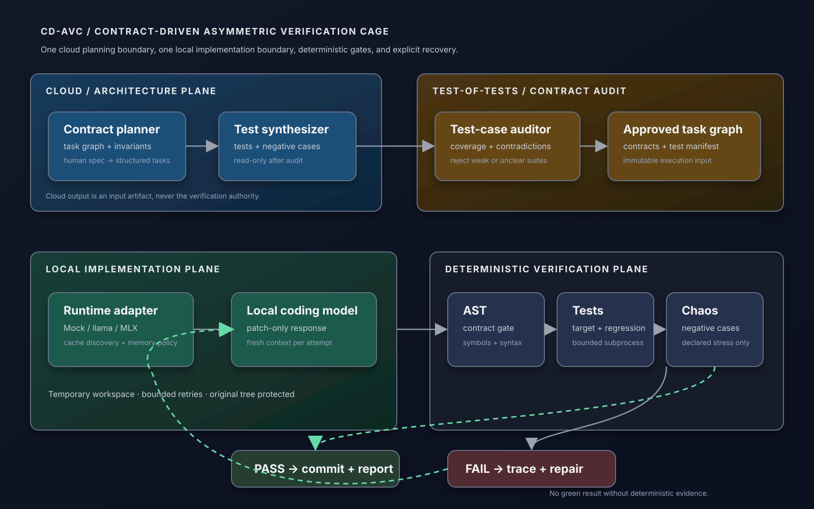

# CD-AVC system design

The diagram records the original v0 proposal (cloud planning is not a runtime requirement):

1. Cloud planning produces contracts and tests.
2. A test-of-tests audit approves the task graph.
3. A local model writes only implementation-file patches.
4. The supervisor runs AST, targeted-test and regression gates.
5. Declared negative/chaos checks run after the deterministic gates.
6. A pass produces a report; a failure feeds a bounded trace back to repair.

## Current P0–P4 runtime

`Supervisor`, `BenchmarkRunner` and offline exported-output adapters use one
`VerificationContract` and shared verifier in `src/cdavc/verification.py`.
Snapshots, contracts, candidate bytes and evidence have stable content digests.
Candidates and command repetitions start from fresh filesystem state; edits
preflight transactionally and publication preserves the verified UTF-8 bytes.

Only public verification selects or repairs a generated candidate. The benchmark
then evaluates the selected immutable artifact once against held-out checks;
there is no scoring-to-generation edge. Call receipts cover generation, errors,
format re-asks and context retrieval. Explicit budgets and source/engine/task
fingerprints prevent incomplete cost claims and incompatible resumptions.

Executable properties and repeated-check triage add evidence but do not turn a
finite test suite into a correctness proof. `accepted_under_declared_checks`
means exactly that. No model or agent is a verification authority, and this is
not an OS security sandbox. See [the implementation guide](VERIFICATION_ROADMAP.md)
for schemas, boundaries and reproducible checks.
